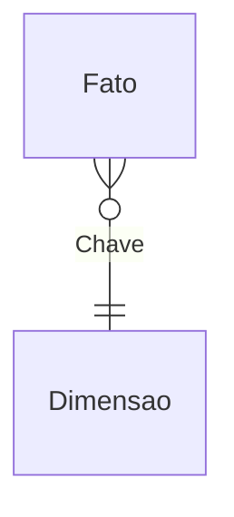

# Modelo de dados

Dicionário de dados do modelo semântico `<Projeto>.SemanticModel`: tabelas, colunas, tipos e relacionamentos, lidos dos arquivos `.tmdl`.

!!! info "Classificação inferida"
    A classificação fato / dimensão / auxiliar foi **inferida** pelo conteúdo e pelos relacionamentos de cada tabela. O modelo não registra essa classificação.

## Visão geral

- **N tabelas**: <n> de negócio e <n> de data automática.
- **N relacionamentos**: <n> entre tabelas de negócio.
- Modo de armazenamento: <import / DirectQuery / misto>.

## Diagrama ER

Só os relacionamentos entre tabelas de negócio. Linha tracejada = relacionamento **inativo**. Nos nomes de tabela, espaços viram `_`. Use o botão de tela cheia, segure **Alt** e role o mouse para dar zoom.

<!-- Mais de ~15 relacionamentos: dividir em visões por assunto (subseções) e manter uma visão completa no fim. Cada relacionamento aparece em uma visão só. -->



## Tabelas

### `<Tabela>`

- **Tipo (inferido):** fato | dimensão | auxiliar
- **Origem:** <fonte> (ver [Fontes de dados](fontes-de-dados.md))

| Coluna | Tipo | Calculada | Observação |
|---|---|---|---|
| | | | |

<!-- Tabela calculada: expressão num bloco recolhível, copiada sem alteração. -->

??? abstract "Expressão DAX da tabela"

    ```dax
    -- copiar da partição `= calculated` do .tmdl
    ```
