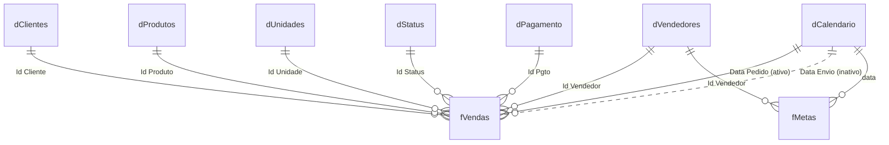

# Modelo de dados

Dicionário de dados do modelo semântico `Performance Comercial.SemanticModel`: tabelas, colunas, tipos e relacionamentos, lidos dos arquivos `.tmdl`.

!!! info "Classificação inferida"
    A classificação fato / dimensão / auxiliar foi **inferida** pelo conteúdo e pelos relacionamentos de cada tabela. O modelo não registra essa classificação. Os prefixos dos nomes (`f`, `d`, `_`, `z`) seguem a convenção do projeto.

## Visão geral

- **11 tabelas**, todas de negócio (nenhuma de data automática): 2 fatos, 7 dimensões e 2 auxiliares.
- **10 relacionamentos** entre tabelas de negócio: 9 ativos e 1 inativo. Todos são de muitos para um, com filtro em uma direção (da dimensão para o fato).
- **53 colunas**, das quais 3 são calculadas (todas em `dCalendario`).
- **50 medidas**, em duas tabelas: `_Medidas` (44) e `zMetricas` (6). Ver [Medidas DAX](medidas-dax/index.md).
- Modo de armazenamento: **Import** em todas as tabelas.
- Cultura do modelo: pt-BR.
- Além das tabelas, o modelo tem 4 expressões compartilhadas do Power Query: a consulta `dCidades` (usada só para montar `dClientes`, não vira tabela) e os 3 parâmetros de caminho dos dados (`Caminho_Extracao`, `Caminho_Dimensoes` e `Caminho_Meta`), reunidos no grupo "Parâmetros de dados". Ver [Fontes de dados](fontes-de-dados.md).

## Diagrama ER

Só os relacionamentos entre tabelas de negócio. Linha tracejada = relacionamento **inativo**. Nos nomes de tabela, espaços viram `_`. Use o botão de tela cheia, segure **Alt** e role o mouse para dar zoom.

Com 10 relacionamentos, o diagrama cabe em uma visão só.



## Relacionamentos

| De (muitos) | Para (um) | Situação |
|---|---|---|
| `fVendas[Id Cliente]` | `dClientes[Id Cliente]` | ativo |
| `fVendas[Id Produto]` | `dProdutos[Id Produto]` | ativo |
| `fVendas[Id Vendedor]` | `dVendedores[Id Vendedor]` | ativo |
| `fVendas[Id Unidade]` | `dUnidades[Id Unidade]` | ativo |
| `fVendas[Id Status]` | `dStatus[Id Status]` | ativo |
| `fVendas[Id Pgto]` | `dPagamento[Id Pagamento]` | ativo |
| `fVendas[Data Pedido]` | `dCalendario[Id Data]` | ativo |
| `fVendas[Data Envio]` | `dCalendario[Id Data]` | **inativo** |
| `fMetas[Id Vendedor]` | `dVendedores[Id Vendedor]` | ativo |
| `fMetas[data]` | `dCalendario[Id Data]` | ativo |

- `dCalendario` é usada por duas colunas de data de `fVendas`. Só `Data Pedido` filtra por padrão.
- `Data Envio` tem relacionamento **inativo**, e nenhuma medida do modelo usa `USERELATIONSHIP`. Na prática, nada no modelo atual filtra por data de envio.
- `fVendas` e `fMetas` não têm relacionamento entre si. Elas se encontram pelas dimensões em comum: `dVendedores` e `dCalendario`.

!!! pendente "A confirmar"
    O relacionamento inativo por `Data Envio` é para uso futuro ou pode ser removido? A documentação anterior diz que ele existe "para análises alternativas".

## Tabelas

### `fVendas`

- **Tipo (inferido):** fato
- **Granularidade:** uma linha por item vendido, segundo a documentação anterior.
- **Origem:** planilha `Vendas.xlsx`, aba `fVendas`, lida da pasta do parâmetro `Caminho_Extracao` (ver [Fontes de dados](fontes-de-dados.md)).

| Coluna | Tipo | Calculada | Observação |
|---|---|---|---|
| `Data Pedido` | data e hora | não | Data do pedido. Liga com `dCalendario` (ativo) |
| `Data Envio` | data e hora | não | Data de envio. Liga com `dCalendario` (inativo) |
| `Num Venda` | texto | não | Número da venda. A medida `11 Qtde Vendas` conta valores distintos desta coluna |
| `Id Produto` | inteiro | não | Chave para `dProdutos` |
| `Id Vendedor` | inteiro | não | Chave para `dVendedores` |
| `Id Cliente` | inteiro | não | Chave para `dClientes` |
| `Id Unidade` | inteiro | não | Chave para `dUnidades` |
| `Id Status` | inteiro | não | Chave para `dStatus` |
| `Id Pgto` | inteiro | não | Chave para `dPagamento` (coluna `Id Pagamento`) |
| `Qtde` | inteiro | não | Quantidade vendida |
| `Valor Unit` | decimal | não | Valor unitário |
| `Custo Unit` | decimal | não | Custo unitário |
| `Despesa Unit` | inteiro | não | Despesa unitária |
| `Impostos Unit` | decimal | não | Impostos por unidade |
| `Comissão Unit` | decimal | não | Comissão por unidade |

A planilha de origem tem mais colunas do que o modelo usa (por exemplo, o nome do vendedor). A consulta mantém só as 15 colunas acima.

!!! pendente "A confirmar"
    Os valores de `Valor Unit`, `Custo Unit`, `Despesa Unit`, `Impostos Unit` e `Comissão Unit` são por unidade vendida e são multiplicados por `Qtde` nas medidas? A documentação anterior diz que sim. Será conferido na página de medidas.

### `fMetas`

- **Tipo (inferido):** fato
- **Granularidade:** uma linha por vendedor e mês.
- **Origem:** todas as planilhas `.xlsx` da pasta do parâmetro `Caminho_Meta` (hoje, `Meta 2018.xlsx` a `Meta 2021.xlsx`). A consulta ignora arquivos temporários do Excel (nome iniciado por `~`), transforma as colunas dos 12 meses em linhas e monta a data a partir do nome do mês e do ano que está no nome do arquivo.

| Coluna | Tipo | Calculada | Observação |
|---|---|---|---|
| `data` | data e hora | não | Mês da meta. Liga com `dCalendario` |
| `Id Vendedor` | inteiro | não | Chave para `dVendedores` |
| `Valor Meta` | decimal | não | Valor da meta do vendedor no mês. Somado pela medida `40 Meta` |

### `dCalendario`

- **Tipo (inferido):** dimensão de data
- **Origem:** gerada no próprio Power Query, sem arquivo. A consulta cria uma lista de **1.461 dias a partir de 01/01/2018**, o que vai até **31/12/2021**.

| Coluna | Tipo | Calculada | Observação |
|---|---|---|---|
| `Id Data` | data e hora | não | Chave. Uma linha por dia |
| `Ano` | inteiro | não | |
| `Nome do Mês` | texto | não | Nome do mês com a primeira letra maiúscula. Ordenado por `Mês` |
| `Mês` | inteiro | não | Número do mês, de 1 a 12 |
| `Dia` | inteiro | não | Dia do mês |
| `Semestre` | texto | não | Valores `Sem1` e `Sem2` |
| `Trimestre` | texto | não | Valores `Tri1` a `Tri4` |
| `Mes Abreviado` | texto | não | Três primeiras letras do nome do mês. Ordenado por `Mês` |
| `Mes-Ano` | texto | não | Mês abreviado e ano, por exemplo `Jan-2018` |
| `Mes Ano Classificação` | inteiro | não | `Ano × 100 + Mês`, por exemplo `201801`. Serve para ordenar |
| `Datas com Venda` | verdadeiro/falso | **sim** | `dCalendario[Id Data] <= MAX(fVendas[Data Pedido])`. Verdadeiro até a última data de venda |
| `Semana dia Num` | inteiro | **sim** | `WEEKDAY(dCalendario[Id Data])`, de 1 (domingo) a 7 (sábado) |
| `Semana dia Nome` | texto | **sim** | Abreviação do dia da semana (`Dom`, `Seg`, ...), a partir de `Semana dia Num`. Ordenado por `Semana dia Num` |

- **Hierarquia `Data`:** `Ano` → `Mes Abreviado` → `Dia`.
- A coluna `Datas com Venda` **não** indica "houve venda neste dia". Ela marca todas as datas até a data da última venda, o que serve para cortar o futuro nas comparações.

!!! pendente "A confirmar"
    O calendário termina em 31/12/2021 e as planilhas de meta também. Os dados de vendas cobrem o mesmo período? Se tiverem datas depois de 2021, essas vendas ficam sem data no calendário.

??? abstract "Expressões das colunas calculadas"

    ```dax
    -- Datas com Venda
    dCalendario[Id Data] <= MAX(fVendas[Data Pedido])

    -- Semana dia Num
    WEEKDAY( dCalendario[Id Data])
    ```

    A expressão de `Semana dia Nome` é um `SWITCH` sobre `Semana dia Num` que devolve as abreviações dos sete dias. O código completo está em `tables/dCalendario.tmdl`.

### `dClientes`

- **Tipo (inferido):** dimensão
- **Origem:** `Dimensões.xlsx`, tabela `Clientes`, lida da pasta do parâmetro `Caminho_Dimensoes`. A consulta junta a consulta `dCidades` (tabela `Cidades` da mesma planilha) pelo `Id Cidade` para trazer cidade, UF e estado.

| Coluna | Tipo | Calculada | Observação |
|---|---|---|---|
| `Id Cliente` | inteiro | não | Chave |
| `Cliente` | texto | não | Nome do cliente |
| `Cidade` | texto | não | Vinda de `dCidades` |
| `UF` | texto | não | Vinda de `dCidades` |
| `Estado` | texto | não | Vinda de `dCidades`, com espaços das pontas removidos |

### `dProdutos`

- **Tipo (inferido):** dimensão
- **Origem:** `Dimensões.xlsx`, tabela `Produtos` (`Caminho_Dimensoes`).

| Coluna | Tipo | Calculada | Observação |
|---|---|---|---|
| `Id Produto` | inteiro | não | Chave |
| `Produto` | texto | não | Nome do produto |
| `Categoria` | texto | não | |
| `Subcategoria` | texto | não | |
| `Marca` | texto | não | |

### `dVendedores`

- **Tipo (inferido):** dimensão
- **Origem:** `Dimensões.xlsx`, tabela `Vendedores` (`Caminho_Dimensoes`).

| Coluna | Tipo | Calculada | Observação |
|---|---|---|---|
| `Id Vendedor` | inteiro | não | Chave |
| `Vendedor` | texto | não | Nome do vendedor |
| `URL Foto` | texto | não | Endereço da foto. É usado em um visual da guia Vendedores |
| `Gerente` | texto | não | Nome do gerente do vendedor |

### `dUnidades`

- **Tipo (inferido):** dimensão
- **Origem:** `Dimensões.xlsx`, tabela `Unidades` (`Caminho_Dimensoes`).

| Coluna | Tipo | Calculada | Observação |
|---|---|---|---|
| `Id Unidade` | inteiro | não | Chave |
| `Unidade` | texto | não | Nome da unidade |

### `dStatus`

- **Tipo (inferido):** dimensão
- **Origem:** `Dimensões.xlsx`, tabela `Status` (`Caminho_Dimensoes`).

| Coluna | Tipo | Calculada | Observação |
|---|---|---|---|
| `Id Status` | inteiro | não | Chave. O valor `1` é o status das vendas efetivadas, usado nas medidas |
| `Status` | texto | não | Descrição do status |

!!! pendente "A confirmar"
    Quais são todos os valores de `Status` e o que cada um significa? A documentação anterior só cita `1 = Efetivado` e `2 = Cancelado`. Esta página não leu os valores da planilha.

### `dPagamento`

- **Tipo (inferido):** dimensão
- **Origem:** `Dimensões.xlsx`, tabela `Pagamento` (`Caminho_Dimensoes`).

| Coluna | Tipo | Calculada | Observação |
|---|---|---|---|
| `Id Pagamento` | inteiro | não | Chave |
| `Forma de Pagamento` | texto | não | Descrição da forma de pagamento |

### `_Medidas`

- **Tipo (inferido):** auxiliar, tabela só de medidas
- **Colunas:** nenhuma. Guarda 44 medidas, organizadas em pastas de exibição. Ver [Medidas DAX](medidas-dax/index.md).

### `zMetricas`

- **Tipo (inferido):** auxiliar
- **Origem:** tabela digitada dentro do Power Query (os valores estão no código da consulta), sem arquivo externo.
- **Medidas:** 6 (`Context Medida z`, `Linha Anterior`, `Linha Atual`, `Seta para Cima`, `Seta para baixo ( limit sup )` e `Seta para baixo ( limit Inferior )`).

| Coluna | Tipo | Calculada | Observação |
|---|---|---|---|
| `Metrica` | texto | não | Nome da métrica. Ordenada por `Ordem` |
| `Ordem` | texto | não | Posição da métrica na ordenação |

!!! pendente "A confirmar"
    Para que serve `zMetricas` no relatório? Pelo nome das medidas, parece apoiar uma tabela de indicadores com setas, mas isso é uma dedução. Será confirmado na página das guias do relatório.
