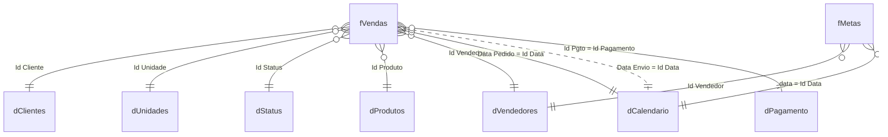

# Modelo de dados

Dicionário de dados do modelo semântico `Performance Comercial.SemanticModel`: tabelas, colunas, tipos e relacionamentos, lidos dos arquivos `.tmdl`.

!!! info "Classificação inferida"
    A classificação fato / dimensão / auxiliar foi **inferida** pelos relacionamentos de cada tabela. O modelo não registra essa classificação.

!!! info "Como esta página é mantida"
    Os blocos entre marcadores `gerado` são reescritos por `gerar_paginas.py`. Escreva observações acima do bloco, nunca dentro dele.

## Visão geral

<!-- gerado:inicio visao-geral -->
- **11 tabelas**: 11 de negócio e 0 de data automática.
- **10 relacionamentos** entre tabelas de negócio (ativos: 9; inativos: 1).
- **Modo de armazenamento:** import.
- **50 medidas** em 4 pastas de exibição ([Medidas DAX](medidas-dax/index.md)).
- **Hierarquias:** 1. **Grupos de cálculo:** 0.
- **Papéis de segurança (RLS):** nenhum papel definido no modelo.
<!-- gerado:fim visao-geral -->

## Diagrama ER

Só os relacionamentos entre tabelas de negócio. Linha tracejada = relacionamento **inativo**. Nos nomes de tabela, caracteres especiais viram `_`.

<!-- gerado:inicio er -->

<!-- gerado:fim er -->

## Tabelas

### `_Medidas`

<!-- gerado:inicio tabela:_Medidas -->
- **Tipo (inferido):** auxiliar (só medidas)
- **Origem:** consulta M (import) (ver [Fontes de dados](fontes-de-dados.md))
- **Medidas:** 44 (ver [Medidas DAX](medidas-dax/index.md))

Tabela sem colunas (contém apenas medidas).
<!-- gerado:fim tabela:_Medidas -->

### `dCalendario`

<!-- gerado:inicio tabela:dCalendario -->
- **Tipo (inferido):** dimensão
- **Origem:** consulta M (import) (ver [Fontes de dados](fontes-de-dados.md))

| Coluna | Tipo | Calculada | Observação |
|---|---|---|---|
| `Id Data` | dateTime | não |  |
| `Ano` | int64 | não |  |
| `Nome do Mês` | string | não |  |
| `Mês` | int64 | não |  |
| `Dia` | int64 | não |  |
| `Semestre` | string | não |  |
| `Trimestre` | string | não |  |
| `Mes Abreviado` | string | não |  |
| `Mes-Ano` | string | não |  |
| `Mes Ano Classificação` | int64 | não |  |
| `Datas com Venda` | (inferido) | sim | ver expressão abaixo |
| `Semana dia Num` | (inferido) | sim | ver expressão abaixo |
| `Semana dia Nome` | (inferido) | sim | ver expressão abaixo |

??? abstract "Expressões das colunas calculadas"

    **`Datas com Venda`**

    ```dax
       dCalendario[Id Data] <= MAX(fVendas[Data Pedido])
    ```

    **`Semana dia Num`**

    ```dax
    WEEKDAY( dCalendario[Id Data])
    ```

    **`Semana dia Nome`**

    ```dax
    SWITCH(
        dCalendario[Semana dia Num],
        1 , "Dom",
        2 , "Seg",
        3 , "Ter",
        4 , "Qua",
        5 , "Qui",
        6 , "Sex",
        7 , "Sab"
    )
    ```
<!-- gerado:fim tabela:dCalendario -->

### `dClientes`

<!-- gerado:inicio tabela:dClientes -->
- **Tipo (inferido):** dimensão
- **Origem:** Excel.Workbook (import) (ver [Fontes de dados](fontes-de-dados.md))

| Coluna | Tipo | Calculada | Observação |
|---|---|---|---|
| `Id Cliente` | int64 | não |  |
| `Cliente` | string | não |  |
| `Cidade` | string | não |  |
| `UF` | string | não |  |
| `Estado` | string | não |  |
<!-- gerado:fim tabela:dClientes -->

### `dPagamento`

<!-- gerado:inicio tabela:dPagamento -->
- **Tipo (inferido):** dimensão
- **Origem:** Excel.Workbook (import) (ver [Fontes de dados](fontes-de-dados.md))

| Coluna | Tipo | Calculada | Observação |
|---|---|---|---|
| `Id Pagamento` | int64 | não |  |
| `Forma de Pagamento` | string | não |  |
<!-- gerado:fim tabela:dPagamento -->

### `dProdutos`

<!-- gerado:inicio tabela:dProdutos -->
- **Tipo (inferido):** dimensão
- **Origem:** Excel.Workbook (import) (ver [Fontes de dados](fontes-de-dados.md))

| Coluna | Tipo | Calculada | Observação |
|---|---|---|---|
| `Id Produto` | int64 | não |  |
| `Produto` | string | não |  |
| `Categoria` | string | não |  |
| `Subcategoria` | string | não |  |
| `Marca` | string | não |  |
<!-- gerado:fim tabela:dProdutos -->

### `dStatus`

<!-- gerado:inicio tabela:dStatus -->
- **Tipo (inferido):** dimensão
- **Origem:** Excel.Workbook (import) (ver [Fontes de dados](fontes-de-dados.md))

| Coluna | Tipo | Calculada | Observação |
|---|---|---|---|
| `Id Status` | int64 | não |  |
| `Status` | string | não |  |
<!-- gerado:fim tabela:dStatus -->

### `dUnidades`

<!-- gerado:inicio tabela:dUnidades -->
- **Tipo (inferido):** dimensão
- **Origem:** Excel.Workbook (import) (ver [Fontes de dados](fontes-de-dados.md))

| Coluna | Tipo | Calculada | Observação |
|---|---|---|---|
| `Id Unidade` | int64 | não |  |
| `Unidade` | string | não |  |
<!-- gerado:fim tabela:dUnidades -->

### `dVendedores`

<!-- gerado:inicio tabela:dVendedores -->
- **Tipo (inferido):** dimensão
- **Origem:** Excel.Workbook (import) (ver [Fontes de dados](fontes-de-dados.md))

| Coluna | Tipo | Calculada | Observação |
|---|---|---|---|
| `Id Vendedor` | int64 | não |  |
| `Vendedor` | string | não |  |
| `URL Foto` | string | não |  |
| `Gerente` | string | não |  |
<!-- gerado:fim tabela:dVendedores -->

### `fMetas`

<!-- gerado:inicio tabela:fMetas -->
- **Tipo (inferido):** fato
- **Origem:** Excel.Workbook, Table.Combine (import) (ver [Fontes de dados](fontes-de-dados.md))

| Coluna | Tipo | Calculada | Observação |
|---|---|---|---|
| `data` | dateTime | não |  |
| `Id Vendedor` | int64 | não |  |
| `Valor Meta` | double | não |  |
<!-- gerado:fim tabela:fMetas -->

### `fVendas`

<!-- gerado:inicio tabela:fVendas -->
- **Tipo (inferido):** fato
- **Origem:** Excel.Workbook (import) (ver [Fontes de dados](fontes-de-dados.md))

| Coluna | Tipo | Calculada | Observação |
|---|---|---|---|
| `Data Pedido` | dateTime | não |  |
| `Data Envio` | dateTime | não |  |
| `Num Venda` | string | não |  |
| `Id Produto` | int64 | não |  |
| `Id Vendedor` | int64 | não |  |
| `Id Cliente` | int64 | não |  |
| `Id Unidade` | int64 | não |  |
| `Id Status` | int64 | não |  |
| `Id Pgto` | int64 | não |  |
| `Qtde` | int64 | não |  |
| `Valor Unit` | double | não |  |
| `Custo Unit` | double | não |  |
| `Despesa Unit` | int64 | não |  |
| `Impostos Unit` | double | não |  |
| `Comissão Unit` | double | não |  |
<!-- gerado:fim tabela:fVendas -->

### `zMetricas`

<!-- gerado:inicio tabela:zMetricas -->
- **Tipo (inferido):** auxiliar
- **Origem:** consulta M (import) (ver [Fontes de dados](fontes-de-dados.md))
- **Medidas:** 6 (ver [Medidas DAX](medidas-dax/index.md))

| Coluna | Tipo | Calculada | Observação |
|---|---|---|---|
| `Metrica` | string | não |  |
| `Ordem` | string | não |  |
<!-- gerado:fim tabela:zMetricas -->

## Hierarquias

<!-- gerado:inicio hierarquias -->
| Tabela | Hierarquia | Níveis (coluna) |
|---|---|---|
| `dCalendario` | Data | Ano → Mes Abreviado → Dia |
<!-- gerado:fim hierarquias -->
